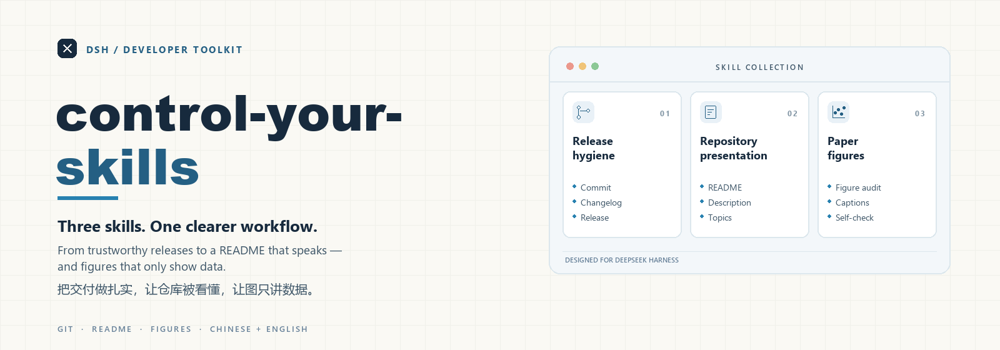

<p align="center">
  
</p>

<h1 align="center">control-your-skills</h1>

<p align="center">Three DeepSeek Harness skills for work that has to hold up in public — Git release discipline, repository presentation, and figures that only show data.</p>

<p align="center"><a href="README.zh.md">中文</a></p>

<p align="center">
  <a href="https://github.com/deepseek-ai/deepseek-harness"></a>
  <a href="https://git-scm.com/doc"></a>
  <a href="https://docs.github.com/en/repositories"></a>
  <a href="https://www.markdownguide.org/"></a>
  <a href="LICENSE"></a>
  <a href="https://github.com/HaoyanZhang123/control-your-skills/releases"></a>
</p>

## Overview

This repository is the home of the skills I use with [DeepSeek Harness](https://github.com/deepseek-ai/deepseek-harness) (DSH). Each skill is a single `SKILL.md`: DSH discovers it from a skills directory and loads it when a task matches its description. There is no build step, no package manager and no runtime dependency.

The set covers getting work out the door and keeping it legible afterwards: changes leave the working tree safely and with readable release text (`git-release-hygiene`); the repository explains itself to a first-time visitor (`github-repository-presentation`); and manuscript figures carry no AI tells while the plotting itself stays unconstrained (`paper-figure-audit`).

## Skills

| Skill | What it does | Use it when |
|---|---|---|
| [`git-release-hygiene`](skills/git-release-hygiene/SKILL.md) | Organizes commits, PRs, changelogs, version numbers, tags and releases from the real Git state. Release and changelog text is written as a complete Chinese block followed by a complete English block. | You are about to commit, open a PR, bump a version, cut a tag, or publish a release. |
| [`github-repository-presentation`](skills/github-repository-presentation/SKILL.md) | Applies one bilingual README skeleton, visual system and wording rules to a GitHub repository, keeps description, topics, badges and release notes consistent, and guides the use of real screenshots for features and workflows. | You are writing or rewriting a repository home page, cover, feature screenshots, badges, description or topics. |
| [`paper-figure-audit`](skills/paper-figure-audit/SKILL.md) | Removes the AI tells from a manuscript figure — text that argues or defends inside the plot, decoration, slide-like structure, one template reused everywhere, fabricated detail — and leaves chart choice, statistics and typography alone. | You are drawing, revising or reviewing a paper figure, writing its caption, or self-checking figures before submission. |

All three skills are written for Chinese-speaking work: their trigger descriptions and rule text are Chinese, while the documents they produce (README, release notes) are bilingual. No English edition of the skill text is included yet.

## Installation

Requirements: a DSH build that loads filesystem skills, and the directory DSH scans for user skills (`<DSH_HOME>/skills`). Each skill must sit directly under that directory, one folder per skill.

Cloning once and linking each skill keeps a single source of truth: edits, `git pull` and new releases take effect without copying files.

```powershell
# 1) clone once
git clone https://github.com/HaoyanZhang123/control-your-skills.git "$HOME\control-your-skills"

# 2) link every skill into the DSH skills directory
$repo = "$HOME\control-your-skills\skills"
$dsh  = Join-Path $env:DSH_HOME "skills"
Get-ChildItem $repo -Directory | ForEach-Object {
    New-Item -ItemType Junction -Path (Join-Path $dsh $_.Name) -Target $_.FullName
}
```

Windows directory junctions do not require administrator rights. If a real folder with the same name already exists (for example a local editable copy of a skill), move it aside first; the link cannot overwrite it.

If you prefer plain copies, copy `skills\<name>\` into the DSH skills directory instead of linking, and re-copy when you want an update.

After adding or removing a skill, open a new DSH session so the skill catalog is rebuilt; the `/` menu may need a page refresh before the new skill appears there. Editing an already loaded skill takes effect without a restart.

Rollback: delete the junction (`Remove-Item "<DSH_HOME>\skills\<name>"`) and restore the folder you moved aside.

## Usage

DSH loads a skill when the task matches its description; you can also name a skill explicitly.

```text
这轮改动整理成两个 commit，再补 CHANGELOG 和 Release 说明
→ git-release-hygiene

按我的规范把 README 重写成中英两份，再给 Description 和 Topics
→ github-repository-presentation

这张图里的指标框和结论句该不该留，帮我去掉 AI 味
→ paper-figure-audit
```

The skills were extracted from daily use, so they encode opinions rather than handle every workflow: they follow an existing project convention when there is one, and only fall back to a proposal when there is none. The figure skill in particular stays deliberately narrow — it removes AI tells and does not police chart type, statistics or typography.

## Repository layout

```text
control-your-skills/
├─ skills/
│  ├─ git-release-hygiene/SKILL.md
│  ├─ github-repository-presentation/SKILL.md
│  └─ paper-figure-audit/SKILL.md
├─ README.md            # English (this file)
├─ README.zh.md         # 中文镜像
├─ CHANGELOG.md
├─ AGENTS.md            # conventions for adding a skill
├─ NOTICE
└─ LICENSE
```

## Updating

- Linked install: run `git pull` in the cloned repository. The next DSH session reads the new text; no reinstall step.
- Copied install: copy `skills\<name>\` again.
- If a DSH upgrade or a plugin reinstall replaces the junction with a real folder, re-run the linking step. Nothing is lost — the repository still holds the content.

## License

[MIT](LICENSE). The first two skills started as skill documents in another project; see [NOTICE](NOTICE) for that record. `paper-figure-audit` was written for this repository.
