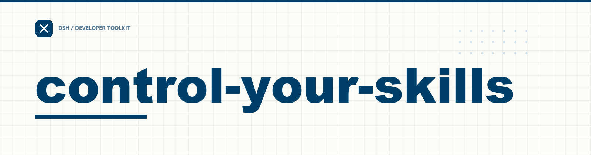

<p align="center">
  
</p>

<h1 align="center">control-your-skills</h1>

<p align="center">七个 DeepSeek Harness skill：先把用户真正想要什么搞清楚，再把交付做扎实——意图对齐、Git 发版纪律、让别人看得懂的仓库呈现、只讲数据的论文配图、图注该怎么写、学术写作与去 AI 味，以及按 DSH 真实加载方式来写的 skill 编写方法。</p>

<p align="center"><a href="README.md">English</a></p>

<p align="center">
  <a href="https://github.com/deepseek-ai/deepseek-harness"></a>
  <a href="https://git-scm.com/doc"></a>
  <a href="https://docs.github.com/en/repositories"></a>
  <a href="https://www.markdownguide.org/"></a>
  <a href="LICENSE"></a>
  <a href="https://github.com/HaoyanZhang123/control-your-skills/releases"></a>
</p>

## 简介

这个仓库放我日常在用的 [DeepSeek Harness](https://github.com/deepseek-ai/deepseek-harness)（DSH）skill。每个 skill 就是一个 `SKILL.md`：DSH 从技能目录里发现它，任务与它的 description 匹配时加载。没有构建步骤，没有包管理器，也没有运行时依赖。

这套 skill 从「你到底想要什么」开始：用户说得含糊、用词不准或自己还没想清时，先结合上下文还原真实意图（`intent-alignment`）；然后把交付做扎实——改动安全、诚实、可读地离开工作区（`git-release-hygiene`）；仓库首页讲清楚自己是什么（`github-repository-presentation`）；论文配图不带 AI 味，同时不干涉你怎么画（`paper-figure-audit`），图注这一层单独交代该说什么、怎么组织（`figure-legend`）；学术写作、润色与去 AI 味共用一套证据纪律（`academic-writing-suite`）；新 skill 按 DSH 真实的加载方式来建（`skill-creator`）。

## 技能

| Skill | 做什么 | 什么时候用 |
|---|---|---|
| [`intent-alignment`](skills/intent-alignment/SKILL.md) | 还原用户真正想要的东西，而不是字面说了什么：先看上下文和项目现状再动手，把用户确认的要求与自己的猜测分开，靠调查、解释概念、比较方案和做低成本可逆小样来降低不确定性，只在猜错会明显改变结果处提问。 | 需求含糊、用词不准、前后矛盾，用户还说不出自己想要什么，或交付后只得到一句「不对」却没说明原因时。目标明确的任务不适用，直接执行。 |
| [`git-release-hygiene`](skills/git-release-hygiene/SKILL.md) | 依据真实 Git 状态组织 Commit、PR、Changelog、版本号、Tag 与 Release；发布文案写成完整中文段加完整英文段。 | 准备提交、开 PR、升版本、打 Tag、发 Release 时。 |
| [`github-repository-presentation`](skills/github-repository-presentation/SKILL.md) | 用同一套双语 README 骨架、视觉与措辞规则整理仓库首页，让 Description、Topics、徽章与 Release Notes 保持一致，并指导用真实截图说明功能与操作流程。 | 写或重写仓库首页、封面、功能截图、徽章、Description、Topics 时。 |
| [`paper-figure-audit`](skills/paper-figure-audit/SKILL.md) | 删掉论文图里的 AI 味——图内替作者说话或辩护的文字、装饰、幻灯片式结构、一套模板套所有图、编造出来的细节——但不管图型、统计与排版。 | 画、改、审论文配图，或投稿前自查图表时。 |
| [`figure-legend`](skills/figure-legend/SKILL.md) | 管图注这一层：总题只放名词短语、逐面板怎么写、统计四要素怎么收进图注、图注能否脱离正文自读、英文图注的时态分工、中文图注怎么处理、复用他人图版的授权署名。 | 写、改或审论文图注，或投稿前检查图表题注时。 |
| [`academic-writing-suite`](skills/academic-writing-suite/SKILL.md) | 学术写作的完整工作台：从素材起草章节与论证、重构整篇骨架、压缩精简、中译英与语言润色、去 AI 味与模板腔、术语与数字一致性清扫、首次投稿材料。含引言写两遍的强制顺序、可机检的机械语体门禁，以及改一处要知道该重开哪些章节的变更影响分级。 | 起草或重写论文章节、润色成稿、轻量去 AI 味、准备投稿包时。 |
| [`skill-creator`](skills/skill-creator/SKILL.md) | 先判断一件事该不该做成 skill，再把它切成 `SKILL.md`、`references/`、`scripts/` 与 `assets/`，写真正能触发它的 description，给对自由度，最后用零依赖脚本校验。 | 新建 skill、重构臃肿的 `SKILL.md`、给已有 skill 补参考文件或脚本、审一个 skill 是否符合格式时。 |

七个 skill 都面向中文工作流：触发描述与规则正文是中文，产出的文档（README、Release 说明、论文正文）按任务需要双语或目标语言。暂未提供英文版 skill 正文。

## 安装

前提：一个会从文件系统加载 skill 的 DSH，以及它扫描的用户技能目录（`<DSH_HOME>/skills`）。每个 skill 必须直接位于该目录下一层，一个 skill 一个文件夹。

只克隆一次、再把每个 skill 联接进去，可以保持单一事实源：改文件、`git pull`、发新版本都无需复制。

```powershell
# 1) 克隆一次
git clone https://github.com/HaoyanZhang123/control-your-skills.git "$HOME\control-your-skills"

# 2) 把每个 skill 联接进 DSH 技能目录
$repo = "$HOME\control-your-skills\skills"
$dsh  = Join-Path $env:DSH_HOME "skills"
Get-ChildItem $repo -Directory | ForEach-Object {
    New-Item -ItemType Junction -Path (Join-Path $dsh $_.Name) -Target $_.FullName
}
```

Windows 目录联接不需要管理员权限。如果同名实目录已存在（比如之前建过的可编辑副本），先把它挪走：联接不能覆盖已有目录。

不想用联接也可以直接复制：把 `skills\<name>\` 复制进 DSH 技能目录，需要更新时再复制一次。

新增或删除 skill 后，开一个新的 DSH 会话让技能目录重建；斜杠菜单可能需要刷新页面才会出现新条目。改动已加载 skill 的正文则无需重启。

回滚：删掉联接（`Remove-Item "<DSH_HOME>\skills\<name>"`），再把你挪走的目录放回去。

## 使用

任务与 description 匹配时 DSH 会自动加载 skill，也可以直接点名。

```text
这轮改动整理成两个 commit，再补 CHANGELOG 和 Release 说明
→ git-release-hygiene

按我的规范把 README 重写成中英两份，再给 Description 和 Topics
→ github-repository-presentation

这张图里的指标框和结论句该不该留，帮我去掉 AI 味
→ paper-figure-audit

这两个面板的图注帮我改一下，总题别写结论
→ figure-legend

把这段引言重写一遍，再顺手按我的机械门禁过一遍
→ academic-writing-suite

这个 SKILL.md 太长了，帮我拆到 references，再补个 description
→ skill-creator

我也说不清这版哪里不对，反正就是不像我要的
→ intent-alignment
```

这些 skill 是从日常使用里抽出来的，带明显偏好：项目已有约定就沿用，没有再提建议，不强行套用某一种提交规范或版本策略。配图那个刻意写得窄——只去 AI 味，不评判图型、统计和排版；图注单独一份，因为「图里不该有句子」和「图注该怎么写」是两件事。学术写作那一个把起草、润色、去 AI 味合在一起，因为三者共用同一套证据纪律，分开反而会让规则漂移。

## 仓库结构

```text
control-your-skills/
├─ skills/
│  ├─ intent-alignment/
│  │  ├─ SKILL.md
│  │  └─ references/exploration-methods.md
│  ├─ git-release-hygiene/SKILL.md
│  ├─ github-repository-presentation/
│  │  ├─ SKILL.md
│  │  └─ references/readme-template.md
│  ├─ paper-figure-audit/SKILL.md
│  ├─ figure-legend/SKILL.md
│  ├─ academic-writing-suite/
│  │  ├─ SKILL.md
│  │  └─ references/
│  │     ├─ drafting.md
│  │     ├─ polishing.md
│  │     └─ de-ai.md
│  └─ skill-creator/
│     ├─ SKILL.md
│     ├─ references/workflows.md
│     ├─ references/output-patterns.md
│     ├─ scripts/quick_validate.py
│     └─ LICENSE.txt
├─ assets/               # 封面与生成脚本（build_cover.py，Pillow）
├─ README.md            # 英文主文件
├─ README.zh.md         # 中文（本文件）
├─ CHANGELOG.md
├─ AGENTS.md            # 新增 skill 的约定
├─ NOTICE
└─ LICENSE
```

## 更新

- 联接安装：在克隆下来的仓库里 `git pull`。下一个 DSH 会话读到新正文，不需要重装。
- 复制安装：重新复制 `skills\<name>\`。
- DSH 升级或插件重装把联接换成实目录时，重新跑一次联接步骤即可。内容不会丢——仓库里仍然有原文。

## 许可证

[MIT](LICENSE)。前两个 skill 最初是另一个项目里的技能文档，来源记录见 [NOTICE](NOTICE)；`paper-figure-audit`、`figure-legend` 与 `intent-alignment` 是为本仓库写的。`skill-creator` 改编自 Anthropic 的 skill-creator（Apache-2.0），已改写为 DSH 原生形态，许可证原文随 skill 目录一起分发。`academic-writing-suite` 的去 AI 味规则、引言写两遍的流程与机械语体门禁、变更影响分级分别改编自三个 MIT 项目，出处同样记在 [NOTICE](NOTICE)。
